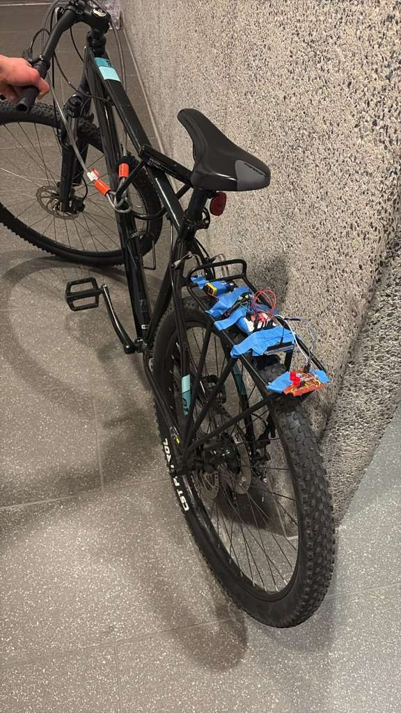

# BrakeBright

A motion-aware smart bike brake light.

  

The rear light runs at a baseline brightness set by ambient light, jumps to full brightness the moment the bike starts braking, then fades smoothly back to baseline.

## Project website

https://upenn-embedded.github.io/final-project-website-submission-f25-t02-f25-schrodingers_firmware/

## Hardware

- ATmega328PB microcontroller (8-bit AVR, 16 MHz)
- LSM6DS0 IMU over I2C to detect deceleration
- Photoresistor on the ADC for ambient light
- Red LED strip driven by an N-channel MOSFET with Timer1 PWM
- 9V battery with a buck converter and a 3.3V LDO for the sensors

## Code

https://github.com/upenn-embedded/final-project-website-submission-f25-t02-f25-schrodingers_firmware
